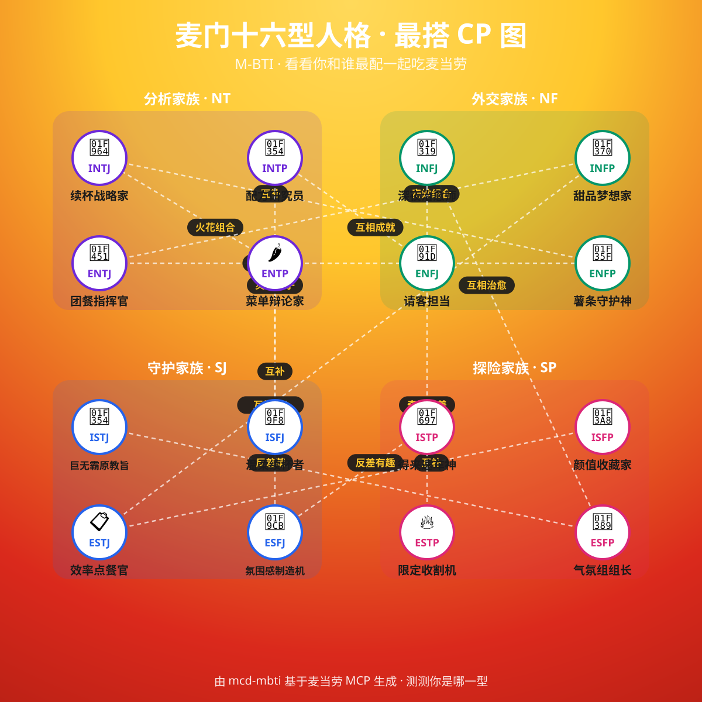

# 🍟 mcd-mbti · 麦门人格鉴定器

> 你是「薯条守护神」还是「巨无霸原教旨主义者」？
> 答 8 道题，测出你的 **麦门十六型人格（M-BTI）**，并基于麦当劳官方 MCP 实时生成你的**本命套餐处方**、匹配的当月活动与可领优惠券——最后给你一张能发朋友圈的**人格卡**。

基于**麦当劳中国官方 MCP** 构建的 Agent Skill。参赛于「麦当劳程序员创意开发大赛」。

> 🌟 觉得有意思的话，点个 Star 支持一下，也欢迎测完把你的「麦门人格卡」发出来，看看你和朋友谁跟谁最搭～


> 上图为人格卡布局/配色示意（由 `src/make-sample-png.js` 零依赖生成）。接入真实 MCP 数据后，用 `src/render.js`（装 puppeteer）导出像素级还原模板的成品卡片。

---

## ✨ 这是什么

榜上大多数麦当劳 Skill 在做「查券 / 查热量 / 年度报告」——要么同质化，要么会被官方年终活动盖过。

mcd-mbti 换一条路：**UGC 式性格测试**。它不读你的隐私数据，而是让你**答题**，然后：

1. 🧠 用麦当劳语境的 4 个维度把你归到 **16 型人格之一**
2. 🍔 用麦当劳 MCP **实时菜单**给你开一张「本命套餐处方」（真的能点到）
3. 📅 匹配**符合你人格调性的当月活动**
4. 🎫 列出**顺手能领的优惠券**
5. 🖼️ 生成一张**人格卡海报**，还告诉你「和哪一型最搭」

测完就想买，测完就想晒——这正是能驱动 GitHub Star 的传播闭环。

## 🧭 四个维度（麦当劳语境）

| 轴 | 一极 | 另一极 |
|----|------|--------|
| 社交能量 | 堂食社牛 **E** | 外送独享 **I** |
| 选择风格 | 固定本命 **S** | 每次尝鲜 **N** |
| 决策依据 | 性价比理性 **T** | 心情/联名感性 **F** |
| 行动节奏 | 提前规划领券 **J** | 到店随缘 **P** |

组合出 16 型，例如：

- 🍟 **薯条守护神 ENFP** — 薯条配快乐，人生才完整！
- 🥤 **续杯战略家 INTJ** — 每一口都在我的计划之内。
- 🍔 **巨无霸原教旨主义者 ISTJ** — 本命套餐，十年如一日。
- 🌙 **深夜治愈师 INFJ** — 一个人的麦当劳，是我的小宇宙。

完整 16 型见 [`src/personas.js`](./src/personas.js)。

### 🔗 最搭 CP 关系图

每一型都有「最搭」的另一型，测完就能找同好对号入座——天然的二次传播点。



> 矢量图 `docs/cp-chart.svg`（文字清晰、可无限缩放）+ 位图示意 `docs/cp-chart.png`，均由 `npm run chart` 从 `personas.js` 的 `match` 数据自动生成。

## 👥 目标用户

- 爱玩 MBTI / 性格测试、喜欢在社交平台晒结果的用户
- 吃麦当劳但有点「选择困难」、想要被推荐本命套餐的用户
- 想顺手发现当月活动与可领券的会员用户

## 🧩 用到的 MCP 能力

真实调用麦当劳官方 MCP 的只读 Tool：`now-time-info`、`query-meals`、`query-meal-detail`、`campaign-calendar`、`available-coupons`、`query-nearby-stores`。
全部只读，不领券、不下单。详见 [`MCP_INTEGRATION.md`](./MCP_INTEGRATION.md)。

## 🚀 安装与使用

### 前置条件

1. 已申请麦当劳中国 MCP Token：https://open.mcd.cn/mcp
2. 支持 Streamable HTTP MCP 的客户端（WorkBuddy / Cursor / Kiro / Cherry Studio / Trae / VSCode 等）
3. Node.js ≥ 18（用于人格卡渲染）

### 第一步：配置 MCP

复制 [`mcp-config.example.json`](./mcp-config.example.json)，把 `${MCD_MCP_TOKEN}` 替换为你的真实 Token，接入客户端：

```json
{
  "mcpServers": {
    "mcd-mcp": {
      "type": "streamablehttp",
      "url": "https://mcp.mcd.cn",
      "headers": { "Authorization": "Bearer ${MCD_MCP_TOKEN}" }
    }
  }
}
```

### 第二步：安装 Skill

将本仓库 `.claude/` 目录（含 `skills/` 与 `commands/`）放入你的项目或客户端技能目录。支持自然语言自动触发，也支持 `/mcd-mbti` 斜杠命令。

### 第三步：开测

直接说：

```
测测我是什么麦门人格
```

或：

```
/mcd-mbti
```

Agent 会逐题提问 → 计分 → 调 MCP 生成本命套餐处方 → 产出人格卡。

### （可选）本地渲染人格卡

```bash
cd src
npm install
# 用示例数据预览（无需 MCP）：
npm run preview:html          # 产出可截图 HTML
# 或传入 Agent 产出的答案 + MCP 数据：
node render.js --answers ./answers.json --mcp ./mcp.json --out ../card.png
# 重新生成 README 里的示意图：
npm run sample:png
```

## 💬 使用示例

**输入：** 「我爱和朋友堂食、每次都想试新品、跟着心情点、从不提前领券，测测我是哪型」

**Agent：**
1. 映射到 `E / N / F / P` → 计分 → **ENFP 🍟 薯条守护神**
2. `query-meals` + 偏好关键词 `薯条/联名/新品/分享` → 本命套餐处方
3. `campaign-calendar` → 挑「新品联名周」等活动
4. `available-coupons` → 「薯条买一送一券」
5. 渲染人格卡 + 文字结果：「你是 🍟 薯条守护神，和 🥤 续杯战略家 INTJ 最互补」

## 📂 项目结构

```
mcd-mbti/
├── README.md
├── CONTEST_DECLARATION.md
├── MCP_INTEGRATION.md
├── mcp-config.example.json
├── .claude/
│   ├── skills/mcd-mbti/SKILL.md    # 技能核心（自然语言触发）
│   └── commands/mcd-mbti.md        # /mcd-mbti 斜杠命令
├── src/
│   ├── questions.js                # 8 道测试题（四维各 2 题）
│   ├── personas.js                 # 麦门十六型人格定义
│   ├── engine.js                   # 计分 + 本命套餐匹配 + 人格卡组装（纯函数）
│   ├── render.js                   # 人格卡渲染（HTML→PNG，可降级 HTML）
│   ├── template.html               # 人格卡模板
│   ├── make-sample-png.js          # 零依赖生成人格卡示意图
│   ├── make-cp-chart.js            # 生成 16 型最搭 CP 关系图
│   ├── sample-answers.json         # 示例答案
│   ├── sample-mcp.json             # 示例 MCP 数据
│   ├── test.js / package.json
├── docs/
│   ├── sample-card.png             # 人格卡示意图
│   ├── cp-chart.svg / cp-chart.png # 最搭 CP 关系图
├── workbuddy.md                    # WorkBuddy 专项（可选）
├── NOTICE.md                       # 声明与免责
└── LICENSE
```

## 🔒 隐私与安全

- 不收集、不存储、不上传任何用户数据；测试答案与 MCP 数据仅本地用于生成人格卡。
- 仓库内无任何真实 Token 或个人敏感信息。
- 所有 MCP 调用均为只读，绝不代替用户领券或下单。

## 📄 License

[MIT License](./LICENSE)，仅供个人非商业用途。相关声明与免责见 [`NOTICE.md`](./NOTICE.md)。

---

*本项目与麦当劳的关系仅限于使用其公开 MCP 能力，不代表任何官方背书。M-BTI 为麦当劳语境下的趣味命名，与 Myers-Briggs® 官方无关。*
